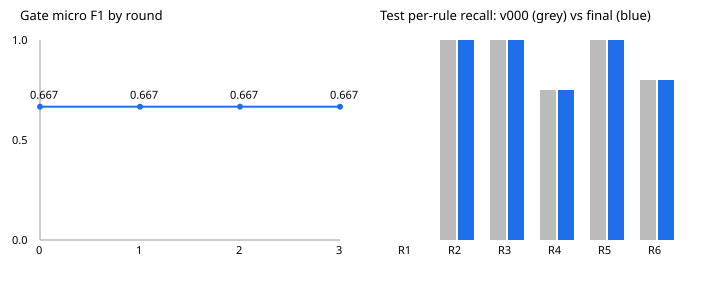

# Self-repair run 20261108T152027Z

Dataset sha256 `c6cc2e21d334541ba16715ed231ff5afe62f42b1e4d5de05e16272c50ea073de`. Budget 3 rounds x 3 candidates. Stop reason: `no_progress`. Final prompt: `v000`.



## Success criteria (PRD section 6)

| # | Criterion | Result | Measured |
|---|---|---|---|
| S1 | accepted patch | FAIL | 0 approved |
| S1a | it raises train micro F1 | FAIL | no patch |
| S1b | it raises gate F1 >= +0.030 and TP >= +2 | FAIL | no patch |
| S1c | no confirmed rule drop or case regression | FAIL | no patch |
| S2 | a rejected candidate with a logged reason code | PASS | case_regression 1, no_f1_gain 4, parse_failures 1, precheck_failed 2, rule_recall_drop 1 |
| S3 | test micro F1 >= baseline + 0.050, more cases improved than worsened | FAIL | 0.809 -> 0.809 (+0.000); improved 0, worsened 0 |
| S4 | test case accuracy >= baseline + 0.050 | FAIL | 0.704 -> 0.704 (+0.000) |
| S5 | no test rule recall below baseline | PASS | none below |
| S6 | parse failures, final <= baseline and <= 5% | PASS | 0.000 -> 0.000 |
| S7 | gate self-test: 3 bad candidates rejected | PASS | 3/3 (flag everything: no_f1_gain, flag nothing: no_f1_gain, helps one rule, wrecks another: rule_recall_drop) |
| S8 | re-run from cache: score delta 0.000 | PASS | delta 0.000, 0 network calls |
| S9 | spot-check >= 14 of 15 | PASS | 15/15 |
| S10 | 90 ads, 26 clean, rule floors, keyword F1 < 0.70 on gate and test | PASS | 90 ads, 26 clean, floors met, keyword gate 0.548 test 0.407 |
| S11 | full run on the free tier, 0 unrecovered API failures | PASS | completed True, 0 exhausted calls, all recovered |
| S12 | test clean FPR <= baseline, adversarial recall >= baseline | PASS | FPR 0.000 -> 0.000; adversarial recall 0.667 -> 0.667 |

## Test (held out, scored once per prompt): v000 vs v000

| Metric | v000 | final |
|---|---|---|
| micro_f1 | 0.809 (tp 19, fp 3 fn 6) | 0.809 (tp 19, fp 3 fn 6) |
| precision | 0.864 (19/22) | 0.864 (19/22) |
| recall | 0.760 (19/25) | 0.760 (19/25) |
| case_accuracy | 0.704 (19/27) | 0.704 (19/27) |
| parse_failure_rate | 0.000 (0/27) | 0.000 (0/27) |
| off_span_rate | 0.045 (1/22) | 0.045 (1/22) |
| hallucinated_quote_rate | 0.000 (0/22) | 0.000 (0/22) |
| clean_fpr | 0.000 (0/8) | 0.000 (0/8) |
| adversarial_recall | 0.667 (2/3) | 0.667 (2/3) |
| rule_recall[R1] | 0.000 (0/4) | 0.000 (0/4) |
| rule_recall[R2] | 1.000 (4/4) | 1.000 (4/4) |
| rule_recall[R3] | 1.000 (4/4) | 1.000 (4/4) |
| rule_recall[R4] | 0.750 (3/4) | 0.750 (3/4) |
| rule_recall[R5] | 1.000 (4/4) | 1.000 (4/4) |
| rule_recall[R6] | 0.800 (4/5) | 0.800 (4/5) |

Per-rule recall bars (v000, then final):

```
R1  .................... 0.000   .................... 0.000
R2  #################### 1.000   #################### 1.000
R3  #################### 1.000   #################### 1.000
R4  ###############..... 0.750   ###############..... 0.750
R5  #################### 1.000   #################### 1.000
R6  ################.... 0.800   ################.... 0.800
```

## Gate: v000 vs v000

| Metric | v000 | final |
|---|---|---|
| micro_f1 | 0.667 (tp 16, fp 7 fn 9) | 0.667 (tp 16, fp 7 fn 9) |
| precision | 0.696 (16/23) | 0.696 (16/23) |
| recall | 0.640 (16/25) | 0.640 (16/25) |
| case_accuracy | 0.593 (16/27) | 0.593 (16/27) |
| parse_failure_rate | 0.000 (0/27) | 0.000 (0/27) |
| off_span_rate | 0.043 (1/23) | 0.043 (1/23) |
| hallucinated_quote_rate | 0.000 (0/23) | 0.000 (0/23) |
| clean_fpr | 0.000 (0/8) | 0.000 (0/8) |
| adversarial_recall | 0.667 (2/3) | 0.667 (2/3) |
| rule_recall[R1] | 0.000 (0/4) | 0.000 (0/4) |
| rule_recall[R2] | 1.000 (4/4) | 1.000 (4/4) |
| rule_recall[R3] | 1.000 (4/4) | 1.000 (4/4) |
| rule_recall[R4] | 0.500 (2/4) | 0.500 (2/4) |
| rule_recall[R5] | 0.750 (3/4) | 0.750 (3/4) |
| rule_recall[R6] | 0.600 (3/5) | 0.600 (3/5) |

## Train: v000 vs v000

| Metric | v000 | final |
|---|---|---|
| micro_f1 | 0.769 (tp 25, fp 7 fn 8) | 0.769 (tp 25, fp 7 fn 8) |
| precision | 0.781 (25/32) | 0.781 (25/32) |
| recall | 0.758 (25/33) | 0.758 (25/33) |
| case_accuracy | 0.611 (22/36) | 0.611 (22/36) |
| parse_failure_rate | 0.000 (0/36) | 0.000 (0/36) |
| off_span_rate | 0.000 (0/32) | 0.000 (0/32) |
| hallucinated_quote_rate | 0.000 (0/32) | 0.000 (0/32) |
| clean_fpr | 0.300 (3/10) | 0.300 (3/10) |
| adversarial_recall | 1.000 (3/3) | 1.000 (3/3) |
| rule_recall[R1] | 0.167 (1/6) | 0.167 (1/6) |
| rule_recall[R2] | 1.000 (5/5) | 1.000 (5/5) |
| rule_recall[R3] | 1.000 (5/5) | 1.000 (5/5) |
| rule_recall[R4] | 0.600 (3/5) | 0.600 (3/5) |
| rule_recall[R5] | 1.000 (6/6) | 1.000 (6/6) |
| rule_recall[R6] | 0.833 (5/6) | 0.833 (5/6) |

## Accepted patches

None.

## Candidates and verdicts

| Round | Cand | Section | Verdict | Gate dF1 | Train dF1 |
|---|---|---|---|---|---|
| 1 | 1 | role | case_regression | +0.064 | +0.037 |
| 1 | 2 | rule_definitions | precheck_failed |  |  |
| 1 | 3 | decision_rules | no_f1_gain | -0.032 |  |
| 2 | 1 | role | no_f1_gain | +0.000 |  |
| 2 | 2 | rule_definitions | parse_failures | +0.083 |  |
| 2 | 3 | decision_rules | rule_recall_drop | +0.083 | -0.007 |
| 3 | 1 | role | no_f1_gain | +0.013 |  |
| 3 | 2 | rule_definitions | precheck_failed |  |  |
| 3 | 3 | decision_rules | no_f1_gain | -0.056 |  |

Rejections by reason code: `case_regression` 1, `no_f1_gain` 4, `parse_failures` 1, `precheck_failed` 2, `rule_recall_drop` 1
